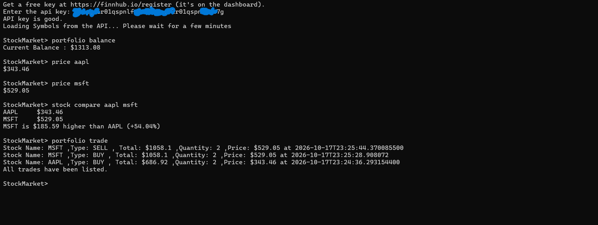

# StockMarket CLI

StockMarket is a CLI based application. It uses **FINNHUB** api key to fetch stock names and displays the data. It uses java with [picocli](https://picocli.info) to run the application.

*Note*: The demo is only available for windows. The code is cross-platform.

## Requirements

- **Windows release (`.exe`):** nothing, Java is bundled.
- **Running from source:** Java 21 or newer.
- A free Finnhub API key.

## Get a Finnhub API key

1. Go to https://finnhub.io/register and create a free account.
2. Open the dashboard at https://finnhub.io/dashboard and copy your API key. It looks like this: **db6ugv1r01qspnlfde70soaugv1r01qspnlfde7g**
3. Paste it when the app asks for it on startup.

The free plan allows 60 API calls per minute.

# Project in action


# How to run it

1. Visit this page https://github.com/Blunt444/StockMarket/releases/tag/v0.0.1 and download the latest zip file.
2. After downloading the zip file. Extract the zip file from your downloaded location.
3. After extracting the zip file. Click the .exe file from it and run it.

# How to run the code

1. Pull the latest commit from this link https://github.com/Blunt444/StockMarket.git
2. Open the terminal ctrl + ` (windows)
3. Run this command

(Windows)
```bash
.\gradlew.bat --console=plain -q run
```
(Linux/Macos)
```bash
./gradlew --console=plain -q run
```
on /StockMarket

# Commands

```bash
price aapl
```

```bash
stock info aapl
```

```bash
stock list
```

```bash
stock list 10
```

```bash
stock compare aapl tsla
```

```bash
portfolio buy aapl 5
```

```bash
portfolio sell aapl 3
```

```bash
portfolio balance
```

```bash
portfolio deposit 1000
```

```bash
portfolio withdraw 500
```

```bash
portfolio list
```

```bash
portfolio list 10
```

```bash
portfolio statement
```

```bash
portfolio statement 10
```

```bash
portfolio trade
```

```bash
portfolio trade 10
```

```bash
portfolio fav add aapl
```

```bash
portfolio fav remove aapl
```

```bash
portfolio fav list
```

```bash
portfolio fav list 10
```

```bash
quit
```

```bash
exit
```

| Command | What it does |
|---|---|
| `price <stock name>` | Current price of the stock |
| `stock info <stock name>` | Detailed info of that particular stock |
| `stock list x` | List first x alphabetical stocks with detailed info. If x is not provided it will take first 10 |
| `stock compare <stock name> <stockname>` | Compares the stock and provide insight |
| `portfolio buy <stock name> x` | Buys the provided stock with x quantity |
| `portfolio sell <stock name> x` | Sells the provided stock with x quantity from your holdings |
| `portfolio balance` | Shows your current balance amount |
| `portfolio deposit x` | Deposit x amount to your balance amount |
| `portfolio withdraw x` | Withdraws x amount from your balance amount |
| `portfolio list x` | List x stocks you hold right now(alphabetical order). If no x is provided it takes default as 10 |
| `portfolio statement x` | List last x statements such as buy/sell/deposit/withdraw. If no x is provided it takes default as 10 |
| `portfolio trade x` | List last x trades you did. Only buy/sell. If no x is provided it takes default as 10 |
| `portfolio fav add <stock name>` | Adds the provided stock into your favorites |
| `portfolio fav remove <stock name>` | Removes the provided stock from your favorites if it present |
| `portfolio fav list x` | List the x favorites from your favorites. if no x is provided it takes default as 10 |
| `quit` | Quit the application |
| `exit` | Quit the application |

## Where your data is saved

Your balance, holdings, transactions and favorites are saved to `~/.stockmarket/data.json` (on Windows: `C:\Users\<you>\.stockmarket\data.json`). Delete that file to reset everything.


## License
This project is licensed under the MIT License. See the [LICENSE](LICENSE) file.